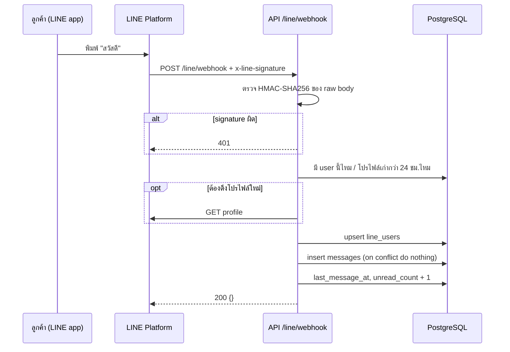
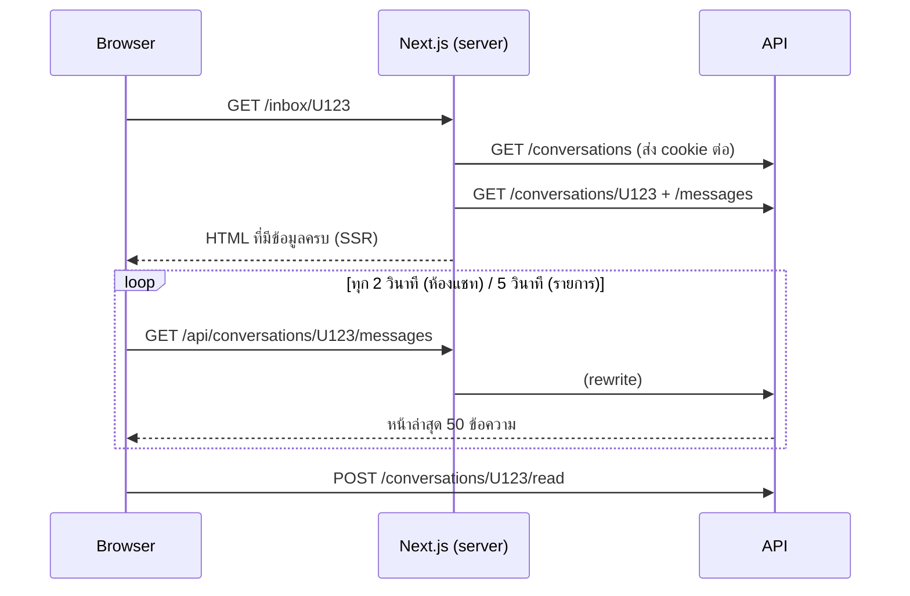
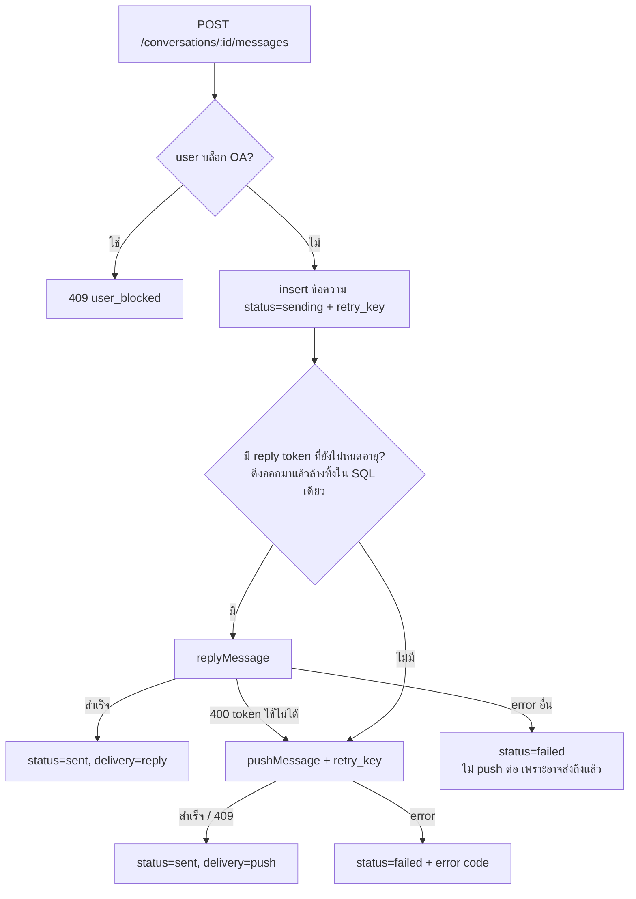
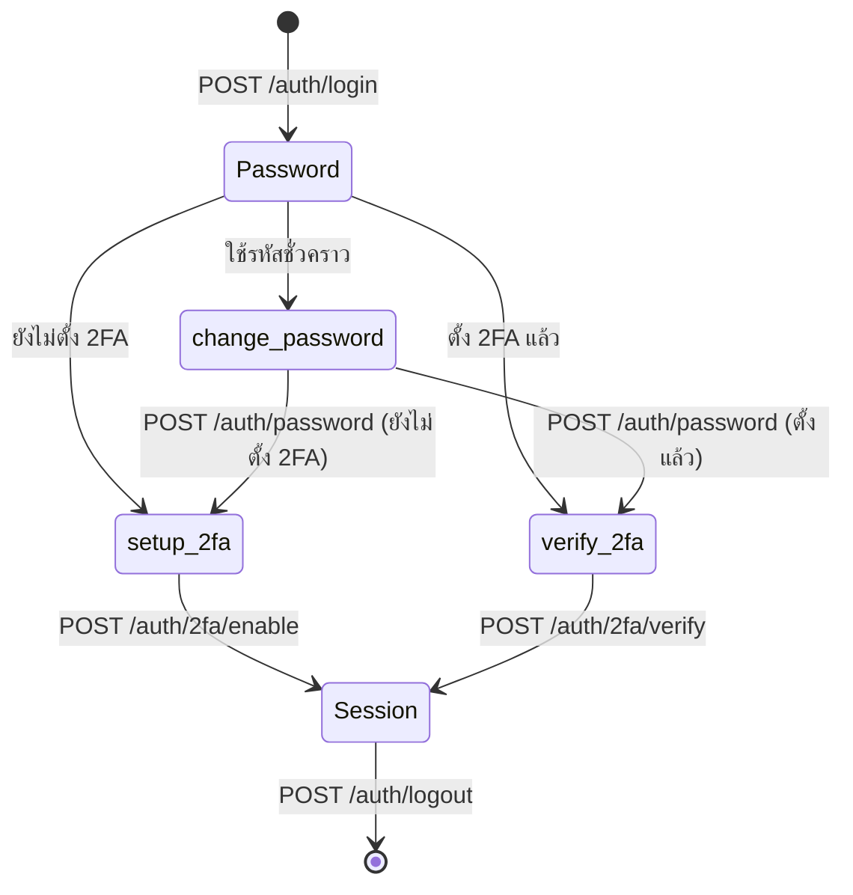
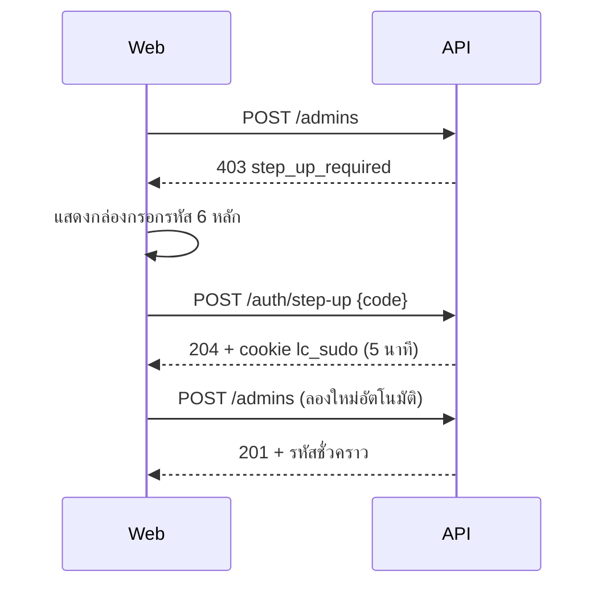

# LineChatbot — ระบบทำงานอย่างไร

เอกสารนี้อธิบายการทำงานของระบบตั้งแต่ข้อความเข้ามาจาก LINE จนถึงตอนที่แอดมินตอบกลับ รวมถึง API ทุกตัว ระบบ login และเหตุผลของการออกแบบแต่ละจุด

## สารบัญ

1. [ภาพรวม](#1-ภาพรวม)
2. [โครงสร้างโปรเจกต์](#2-โครงสร้างโปรเจกต์)
3. [ฐานข้อมูล](#3-ฐานข้อมูล)
4. [รับข้อความจาก LINE (Webhook)](#4-รับข้อความจาก-line-webhook)
5. [ดูข้อความใน Inbox](#5-ดูข้อความใน-inbox)
6. [ตอบกลับ (Reply / Push)](#6-ตอบกลับ-reply--push)
7. [Login และ 2FA](#7-login-และ-2fa)
8. [จัดการแอดมิน](#8-จัดการแอดมิน)
9. [API Reference](#9-api-reference)
10. [Error codes](#10-error-codes)
11. [ความปลอดภัย](#11-ความปลอดภัย)
12. [รันในเครื่อง](#12-รันในเครื่อง)
13. [การทดสอบ](#13-การทดสอบ)
14. [ข้อจำกัดที่รู้อยู่](#14-ข้อจำกัดที่รู้อยู่)

---

## 1. ภาพรวม

ระบบนี้เป็นหลังบ้านของ LINE Official Account ลูกค้าคุยกับ OA ผ่านแอป LINE ตามปกติ ส่วนแอดมินเปิดเว็บเพื่อดูว่าใครทักมา อ่านประวัติแชท และพิมพ์ตอบกลับในนามของ OA

```
┌────────────┐   แชท    ┌───────────────┐  webhook (POST)  ┌──────────────────────┐
│ ลูกค้า (LINE) │ ───────▶ │ LINE Platform │ ───────────────▶ │ API: NestJS + Fastify │
│            │ ◀─────── │               │ ◀─────────────── │  /line/webhook        │
└────────────┘  ข้อความ  └───────────────┘ reply / push API  └──────────┬───────────┘
                                                                     │ Drizzle ORM
                                                                     ▼
┌─────────────────────────┐  /api/* (rewrite)   ┌──────────────────────┐
│ เบราว์เซอร์ของแอดมิน         │ ──────────────────▶ │ Web: Next.js (SSR)    │──▶ PostgreSQL
│ (cookie session)         │ ◀────────────────── │  /inbox, /admins      │
└─────────────────────────┘   HTML + polling    └──────────────────────┘
```

| ส่วน | เทคโนโลยี | หน้าที่ |
|---|---|---|
| `apps/api` | NestJS 12 + Fastify adapter, Drizzle ORM, `@line/bot-sdk` | รับ webhook, เก็บข้อความ, ส่งข้อความกลับ, ระบบ login |
| `apps/web` | Next.js 16 (App Router, SSR), Tailwind CSS v4, SWR | หน้า Inbox, ห้องแชท, login, จัดการแอดมิน |
| DB | PostgreSQL 17 | ผู้ใช้ LINE, ข้อความ, แอดมิน, audit log |

### ทำไมเว็บถึงเรียก API ผ่าน `/api/*`

Next.js ตั้ง `rewrites` ให้ `/api/:path*` ส่งต่อไปที่ API ([next.config.ts](../apps/web/next.config.ts)) เบราว์เซอร์จึงคุยกับโดเมนเดียวเท่านั้น ข้อดีคือ
- cookie ของ session เป็น first-party ไม่ต้องตั้ง CORS และไม่โดน third-party cookie block
- API ตรวจ header `Origin` เพื่อกัน CSRF ได้ง่าย เพราะ origin ที่ถูกต้องมีค่าเดียว

ส่วน webhook ของ LINE ยิงตรงเข้า API ไม่ผ่านเว็บ

---

## 2. โครงสร้างโปรเจกต์

```
line-chatbot/
├── apps/
│   ├── api/                      # NestJS + Fastify
│   │   ├── api/index.js          # entrypoint บน Vercel (serverless)
│   │   ├── drizzle/              # SQL migrations
│   │   ├── scripts/              # migrate, seed super admin, seed ข้อมูลตัวอย่าง
│   │   ├── src/
│   │   │   ├── app.ts            # สร้าง Fastify app (ใช้ทั้งในเครื่องและบน Vercel)
│   │   │   ├── config/env.ts     # ตรวจ env ตอนเปิดระบบ
│   │   │   ├── db/               # schema + connection pool
│   │   │   ├── line/             # webhook: ตรวจ signature, จัดการ event
│   │   │   ├── inbox/            # อ่านแชท + ตอบกลับ
│   │   │   ├── auth/             # login, 2FA, guards, audit log
│   │   │   └── admins/           # super admin จัดการแอดมิน
│   │   └── test/                 # e2e tests (ยิงเข้า Postgres จริง)
│   └── web/                      # Next.js
│       └── src/
│           ├── app/              # หน้าเว็บ (inbox, login, admins)
│           ├── components/       # UI
│           ├── lib/              # เรียก API, format วันที่, types
│           └── proxy.ts          # redirect ไป /login ถ้าไม่มี cookie
├── docker-compose.yml            # Postgres สำหรับ dev
└── .github/workflows/            # CI + CodeQL
```

---

## 3. ฐานข้อมูล

นิยามอยู่ที่ [schema.ts](../apps/api/src/db/schema.ts) และมี migration อยู่ใน `apps/api/drizzle/`

### `line_users` — คนที่คุยกับ OA

| คอลัมน์ | ความหมาย |
|---|---|
| `user_id` (PK) | LINE user ID รูปแบบ `U` + hex 32 ตัว |
| `display_name`, `picture_url`, `status_message` | โปรไฟล์จาก LINE |
| `profile_updated_at` | ดึงโปรไฟล์ล่าสุดเมื่อไร ใช้ตัดสินว่าต้องดึงใหม่หรือยัง (ทุก 24 ชม.) |
| `is_following` | `false` เมื่อ user บล็อก OA (ได้ event `unfollow`) |
| `last_message_at` | ใช้เรียงรายการแชท |
| `unread_count` | จำนวนข้อความที่ยังไม่อ่าน |

### `messages` — ทุกข้อความทั้งขาเข้าและขาออก

| คอลัมน์ | ความหมาย |
|---|---|
| `direction` | `in` = ลูกค้าส่งมา, `out` = แอดมินตอบ |
| `type` | `text`, `sticker`, `image`, `video`, `audio`, `file`, `location` |
| `text` / `payload` | ข้อความ หรือรายละเอียดอื่นเป็น JSON เช่น `stickerId` |
| `webhook_event_id`, `line_message_id` | **unique** ใช้กันบันทึกซ้ำเมื่อ LINE ส่ง webhook ซ้ำ |
| `reply_token`, `reply_token_expires_at` | token ที่ใช้ตอบฟรี (ขาเข้าเท่านั้น) และจะถูกล้างทิ้งหลังใช้ |
| `status` | `sending` → `sent` หรือ `failed` |
| `delivery` | ส่งออกด้วย `reply` หรือ `push` |
| `error` | รหัสสาเหตุที่ส่งไม่สำเร็จ |
| `retry_key` | UUID สำหรับกันส่งซ้ำเวลากดลองใหม่ (ดูข้อ 6) |
| `sent_by_admin_id` | แอดมินคนไหนตอบ |

ข้อความเรียกดูด้วย index `(user_id, created_at desc)`

### `admins`, `recovery_codes`, `login_attempts`, `audit_logs`

ใช้กับระบบ login ดูรายละเอียดในข้อ 7–8

---

## 4. รับข้อความจาก LINE (Webhook)

ไฟล์ที่เกี่ยวข้อง: [line-webhook.controller.ts](../apps/api/src/line/line-webhook.controller.ts), [line-signature.guard.ts](../apps/api/src/line/line-signature.guard.ts), [line-webhook.service.ts](../apps/api/src/line/line-webhook.service.ts)

### ลำดับการทำงาน



### 1) ตรวจ signature

LINE เซ็น body ด้วย HMAC-SHA256 โดยใช้ **Channel secret** แล้วส่งผลลัพธ์มาใน header `x-line-signature`

- ต้องใช้ **raw body** (byte ตามที่ส่งมาจริง) ไม่ใช่ JSON ที่ parse แล้ว เพราะการ parse แล้ว stringify กลับอาจได้ byte ไม่เหมือนเดิม ระบบจึงเปิด `rawBody: true` ตอนสร้าง Nest app ([app.ts](../apps/api/src/app.ts))
- เทียบด้วย `validateSignature` ของ LINE SDK ซึ่งใช้ `timingSafeEqual` จึงไม่รั่วข้อมูลผ่านเวลาที่ใช้เทียบ
- ไม่มี signature หรือ signature ผิด → **401** และไม่แตะ DB เลย
- route นี้ติด `@Public()` (ไม่ต้องมี session) และ `@SkipOriginCheck()` (LINE ไม่ส่ง Origin มา) เพราะยืนยันตัวตนด้วย signature แทน

### 2) จัดการ event

LINE อาจส่งหลาย event มาใน request เดียว ระบบวนทำทีละตัว:

| Event | สิ่งที่ทำ |
|---|---|
| `message` | อัปเดต user → บันทึกข้อความ → เพิ่ม unread |
| `follow` | ดึงโปรไฟล์ใหม่ทันที, `is_following = true` |
| `unfollow` | `is_following = false` (ดึงโปรไฟล์ไม่ได้แล้วเพราะถูกบล็อก) |
| อื่นๆ | ข้าม |
| จากกลุ่มหรือห้องแชท | ข้าม (โจทย์คือแชท 1:1) |

ปุ่ม **Verify** ใน LINE Console จะส่ง `events: []` มา ระบบตอบ 200 ตามปกติ

### 3) แปลงข้อความ

[line-message.mapper.ts](../apps/api/src/line/line-message.mapper.ts) แปลงข้อความของ LINE เป็นรูปแบบที่เก็บ และ**ทิ้ง token ที่ LINE แนบมา** เช่น `quoteToken`:

| ประเภท | `text` | `payload` |
|---|---|---|
| text | ข้อความ | – |
| sticker | – | `packageId`, `stickerId`, `stickerResourceType` |
| location | ที่อยู่ | `title`, `address`, `latitude`, `longitude` |
| file | ชื่อไฟล์ | `fileName`, `fileSize` |
| image / video / audio | – | `contentProvider` |

### 4) กันข้อความซ้ำ (idempotent)

ถ้า server ตอบช้าหรือ error, LINE จะส่ง webhook เดิมซ้ำ (redelivery) ระบบรับมือโดย:
- `webhook_event_id` และ `line_message_id` เป็น **unique**
- insert ด้วย `ON CONFLICT DO NOTHING` แล้วเพิ่ม `unread_count` **เฉพาะเมื่อ insert ได้จริง**

ส่งซ้ำกี่รอบผลก็เหมือนส่งครั้งเดียว

### 5) เก็บ reply token

ข้อความขาเข้ามาพร้อม `replyToken` ระบบเก็บไว้พร้อมเวลาหมดอายุที่ **50 วินาที** หลังเวลาของ event (ตั้งให้สั้นกว่าเวลาจริงของ LINE เผื่อไว้) เพื่อใช้ตอบแบบไม่เสียโควตาในข้อ 6

### 6) ดึงโปรไฟล์อย่างประหยัด

ดึง `getProfile` เฉพาะเมื่อเป็น user ใหม่, โปรไฟล์เก่ากว่า 24 ชม. หรือเป็น event `follow` ถ้าดึงไม่ได้ (เช่น user บล็อก) **ยังบันทึกข้อความไว้** แต่ชื่อจะว่างและเว็บแสดงเป็น "ผู้ใช้ LINE"

### 7) บันทึกให้เสร็จก่อนตอบ 200

บน Vercel ฟังก์ชันอาจถูกหยุดทันทีหลังส่ง response ถ้าตอบ 200 ก่อนแล้วค่อยบันทึก ข้อความอาจหาย ระบบจึง `await` การบันทึกทั้งหมดก่อนตอบ

---

## 5. ดูข้อความใน Inbox

ไฟล์ที่เกี่ยวข้อง: [inbox.service.ts](../apps/api/src/inbox/inbox.service.ts), [conversation-list.tsx](../apps/web/src/components/inbox/conversation-list.tsx), [chat-thread.tsx](../apps/web/src/components/inbox/chat-thread.tsx)

### หน้าเว็บ

| Route | แสดงอะไร |
|---|---|
| `/inbox` | รายการแชท (ซ้าย) และช่องว่างให้เลือกแชท |
| `/inbox/[userId]` | รายการแชท + ห้องแชท + ข้อมูลผู้ติดต่อ |

### SSR ครั้งแรก แล้ว polling ต่อ



- **SSR:** หน้าแรกส่ง HTML ที่มีข้อความมาแล้ว ([api.server.ts](../apps/web/src/lib/api.server.ts) ส่ง cookie ของผู้ใช้ต่อไปให้ API และตั้ง `cache: "no-store"` เพราะข้อมูลแชทห้าม cache) ถ้า API ตอบ 401 จะ redirect ไป `/login`
- **Polling ด้วย SWR:** Vercel เปิด WebSocket ค้างไว้ไม่ได้ จึงใช้การดึงซ้ำ SWR หยุดดึงเองเมื่อแท็บถูกซ่อน

### ทำไมดึง "หน้าล่าสุด" ซ้ำ แทนที่จะดึงด้วย `?after=<เวลา>`

ข้อความขาเข้าใช้เวลาของ event จาก LINE แต่ webhook อาจมาถึงช้า ถ้าดึงแบบ "ขอเฉพาะข้อความหลังเวลา X" ข้อความที่มาช้าแต่มีเวลาเก่ากว่า X จะหลุดไป ระบบจึง:
1. ดึงหน้าล่าสุด (50 ข้อความ) ซ้ำทุก 2 วินาที
2. รวมกับข้อความเก่าที่โหลดไว้แล้ว โดยใช้ `id` เป็นตัวกันซ้ำ แล้วเรียงตามเวลา

### โหลดข้อความเก่า

`GET /conversations/:userId/messages?before=<createdAt ของข้อความเก่าสุด>` ได้หน้าก่อนหน้าพร้อม `hasMore` ฝั่งเว็บรักษาตำแหน่ง scroll ไว้ไม่ให้กระโดด

### อ่านแล้ว

เมื่อเปิดห้อง หรือมีข้อความขาเข้าใหม่ระหว่างที่เปิดอยู่ เว็บจะเรียก `POST /conversations/:userId/read` เพื่อตั้ง `unread_count = 0` แล้วรีเฟรชรายการแชท

### รายการแชท

- เรียงตาม `last_message_at desc nulls last` (สูงสุด 200 รายการ)
- ข้อความล่าสุดของแต่ละคนดึงด้วย `SELECT DISTINCT ON (user_id)` ใน query เดียว ไม่ยิงทีละคน
- ค้นหาชื่อด้วย `ILIKE` โดย escape `%` และ `_` ก่อน ไม่อย่างนั้นการค้น `%` จะได้ทุกคน
- **ไม่ส่ง `reply_token` และ `retry_key` ออกไปนอก API เลย** เลือกคอลัมน์ที่ส่งออกไว้ชัดเจนใน `messageColumns`

---

## 6. ตอบกลับ (Reply / Push)

ไฟล์ที่เกี่ยวข้อง: [reply.service.ts](../apps/api/src/inbox/reply.service.ts), [composer.tsx](../apps/web/src/components/inbox/composer.tsx), [chat-thread.tsx](../apps/web/src/components/inbox/chat-thread.tsx)

### LINE มี 2 วิธีส่งข้อความ

| | Reply API | Push API |
|---|---|---|
| ต้องมี | `replyToken` จากข้อความที่ลูกค้าเพิ่งส่ง | `userId` |
| เวลา | ต้องใช้ภายในเวลาสั้นๆ และใช้ได้ครั้งเดียว | ส่งเมื่อไรก็ได้ |
| โควตา | **ไม่นับ** | นับโควตาข้อความรายเดือน |

ระบบจึงพยายามใช้ reply ก่อนเสมอ ถ้าไม่ได้จึงใช้ push

### Flow



### 1) บันทึกก่อน ส่งทีหลัง

ข้อความถูก insert เป็น `sending` ก่อนเรียก LINE ถ้า process ตายกลางทาง ก็ยังมีร่องรอยใน DB และจะไม่มีข้อความที่ส่งถึงลูกค้าแต่ไม่อยู่ใน DB

### 2) ใช้ reply token ได้ครั้งเดียวจริงๆ

```sql
with target as (
  select id, reply_token from messages
  where user_id = $1 and direction = 'in'
    and reply_token is not null and reply_token_expires_at > now()
  order by created_at desc
  limit 1
  for update skip locked
)
update messages as m set reply_token = null
from target where m.id = target.id
returning target.reply_token
```

หา token ล่าสุดที่ยังไม่หมดอายุ แล้ว**ล้างทิ้งในคำสั่งเดียวกัน** (`FOR UPDATE SKIP LOCKED`) ถ้าแอดมิน 2 คนกดส่งพร้อมกัน จะมีแค่คนเดียวที่ได้ token อีกคนไปใช้ push

### 3) ตัดสินใจเมื่อ reply ล้มเหลว

- **400** = token ใช้ไม่ได้ (หมดอายุหรือถูกใช้แล้ว) LINE ยืนยันว่าไม่ได้ส่ง → push แทนได้อย่างปลอดภัย
- **error อื่น** (5xx หรือ network) ไม่รู้ว่า LINE ส่งไปแล้วหรือยัง ถ้า push ต่อ ลูกค้าอาจได้ข้อความซ้ำ → บันทึกเป็น `failed` ให้แอดมินตัดสินใจกดลองใหม่เอง

### 4) ลองใหม่โดยไม่ส่งซ้ำ: `retry_key`

ทุกข้อความขาออกมี `retry_key` (UUID) ซึ่งส่งไปเป็น header `X-Line-Retry-Key` ตอนเรียก push
- ถ้าครั้งแรก LINE ได้รับแล้วแต่เรา timeout ไปก่อน การลองใหม่ด้วย key เดิม LINE จะตอบ **409** และไม่ส่งซ้ำ → ระบบถือว่าส่งสำเร็จ
- `POST /conversations/:userId/messages/:messageId/retry` ใช้ key เดิมทุกครั้ง

### 5) Error codes ของการส่ง

| code | สาเหตุ | ข้อความบนเว็บ |
|---|---|---|
| `quota_exceeded` | LINE ตอบ 429 | โควตาข้อความของ OA เดือนนี้หมดแล้ว |
| `line_auth` | LINE ตอบ 401 | Channel access token ของ LINE ไม่ถูกต้อง |
| `line_rejected` | 400 / 403 / 404 | LINE ไม่รับข้อความนี้ |
| `line_unavailable` | อื่นๆ | เชื่อมต่อ LINE ไม่ได้ |

### 6) ฝั่งเว็บ: Optimistic UI

1. กดส่ง → เพิ่ม bubble ชั่วคราว (`id = local-<uuid>`, `status = sending`) ทันที
2. API ตอบ → แทนที่ด้วยข้อความจริงจาก server
3. ส่งไม่สำเร็จ → bubble แสดงสาเหตุและปุ่ม "ลองใหม่"
   - ถ้าเป็นข้อความที่ยังไม่ถึง API (`local-*`) จะส่งใหม่ทั้งข้อความ
   - ถ้ามี id จริงแล้ว จะเรียก endpoint `/retry`

ช่องพิมพ์: Enter ส่ง, Shift+Enter ขึ้นบรรทัดใหม่ และ**ไม่ส่งระหว่างพิมพ์ด้วย IME** (`isComposing`) เพราะคีย์บอร์ดภาษาไทยบางแบบใช้ Enter เลือกคำ ข้อความจำกัด 1–5,000 ตัวอักษรตามลิมิตของ LINE

---

## 7. Login และ 2FA

ไฟล์ที่เกี่ยวข้อง: [auth.service.ts](../apps/api/src/auth/auth.service.ts), [auth.guard.ts](../apps/api/src/auth/auth.guard.ts), [token.service.ts](../apps/api/src/auth/token.service.ts), [totp.service.ts](../apps/api/src/auth/totp.service.ts)

### State machine ของการ login



ขั้นถัดไปคำนวณจากสถานะจริงของบัญชีทุกครั้ง (`nextStage()`):
1. `must_change_password` → `change_password`
2. ยังไม่มี `totp_enabled_at` → `setup_2fa`
3. ไม่อย่างนั้น → `verify_2fa`

### Cookie 3 ตัว (JWT HS256, httpOnly, SameSite=Lax)

| Cookie | `aud` | อายุ | ใช้ทำอะไร |
|---|---|---|---|
| `lc_mfa` | `mfa` | 10 นาที | ผ่านรหัสผ่านแล้วแต่ยังไม่ครบทุกขั้น เก็บ `stage` ไว้ข้างใน |
| `lc_session` | `session` | 8 ชม. | เข้าใช้งานได้เต็มที่ |
| `lc_sudo` | `step-up` | 5 นาที | เพิ่งยืนยัน 2FA ซ้ำ ใช้กับรายการสำคัญ (ข้อ 8) |

ทุก token มี `sub` (admin id) และ `ver` (`token_version`) ตอนตรวจ guard โหลดแอดมินจาก DB แล้วเทียบ `ver` ถ้าไม่ตรง (เปลี่ยนรหัสผ่าน, รีเซ็ต, ปิดบัญชี) token ทุกตัวที่ออกไปก่อนหน้าจะใช้ไม่ได้ทันที

### Guards (ทำงานกับทุก request ตามลำดับ)

1. **OriginGuard:** request ที่ไม่ใช่ GET ต้องมี `Origin` ตรงกับ `WEB_ORIGIN` (หรือไม่มี Origin แต่ `Sec-Fetch-Site: same-origin`) ไม่อย่างนั้นได้ 403 `bad_origin` ยกเว้น route ที่ติด `@SkipOriginCheck()`
2. **AuthGuard:**
   - route ที่ติด `@MfaStages(...)` → ต้องมี `lc_mfa` ที่ `stage` อยู่ในรายการ**และ**ตรงกับสถานะจริงของบัญชี จึงข้ามขั้นไม่ได้
   - route ที่ติด `@Public()` → ผ่าน
   - ที่เหลือทั้งหมด → ต้องมี `lc_session` ที่ถูกต้อง, บัญชีเปิดใช้งาน, ตั้ง 2FA แล้ว และไม่ค้างเปลี่ยนรหัสผ่าน
   - route ที่ติด `@RequireStepUp()` → ต้องมี `lc_sudo` ของแอดมินคนเดียวกันและ `ver` เดียวกันด้วย
3. **RolesGuard:** route ที่ติด `@Roles('SUPER_ADMIN')` ตรวจ role

**ปิดไว้ก่อนเสมอ (deny by default):** route ใหม่ที่ไม่ได้ติด decorator อะไรจะต้องมี session อัตโนมัติ

### รหัสผ่าน

- hash ด้วย **argon2id** (memory 19 MiB, 2 iterations ตามค่าขั้นต่ำที่ OWASP แนะนำ)
- ถ้าไม่พบ username ระบบยังคำนวณ hash หลอกหนึ่งครั้ง ให้เวลาตอบใกล้เคียงกับกรณีรหัสผิด และตอบ error เดียวกัน (`invalid_credentials`)
- รหัสใหม่ยาว 12–128 ตัว, ห้ามมี username อยู่ข้างใน, ห้ามซ้ำรหัสเดิม
- รหัสชั่วคราวหมดอายุใน 24 ชม.

### TOTP (แอป Authenticator)

- secret สร้างด้วย `otplib` ส่งให้ผู้ใช้เป็น QR (`otpauth://totp/LineChatbot:<username>`) ที่สร้างฝั่ง server และไม่ส่งไปให้บริการภายนอก
- เก็บ secret แบบ**เข้ารหัส AES-256-GCM** ด้วย `TOTP_ENC_KEY` ([crypto.ts](../apps/api/src/auth/crypto.ts)) ถ้า DB หลุด secret ก็ใช้ไม่ได้
- ยอมคลาดเวลา ±30 วินาที (1 step)
- **กันใช้รหัสซ้ำ:** บันทึก `totp_last_used_step` และอัปเดตแบบมีเงื่อนไข (`WHERE last_step IS NULL OR last_step < step`) ส่งรหัสเดียวกันพร้อมกัน 2 ครั้งจะผ่านได้แค่ครั้งเดียว
- ตอน setup ต้องกรอกรหัสที่ถูกต้องก่อน secret จึงจะถูกเปิดใช้

### Recovery codes

- 10 รหัส รูปแบบ `xxxx-xxxx-xxxx` จากตัวอักษรที่ไม่สับสนกัน (ไม่มี 0/o, 1/l/i) สุ่มด้วย `crypto.randomInt`
- เก็บเป็น argon2 hash แสดงให้ผู้ใช้ครั้งเดียวตอนเปิด 2FA
- ใช้ได้ครั้งเดียว (`used_at`) และบันทึก audit `2fa.recovery_code_used`

### จำกัดการลองผิด

[attempts.service.ts](../apps/api/src/auth/attempts.service.ts) เก็บการลองผิดใน Postgres เพราะแต่ละ instance ของ serverless ไม่มี memory ร่วมกัน

| key | ใช้ตอน |
|---|---|
| `user:<username>` | ขั้นรหัสผ่าน |
| `ip:<ip>` | ขั้นรหัสผ่าน |
| `2fa:<adminId>` | ยืนยัน 2FA, setup, step-up |

ผิดครบ **5 ครั้งใน 15 นาที** สำหรับ key ใดก็ตาม → 429 `too_many_attempts` แม้รหัสครั้งถัดไปจะถูก

---

## 8. จัดการแอดมิน

ไฟล์ที่เกี่ยวข้อง: [admins.service.ts](../apps/api/src/admins/admins.service.ts), [admins-view.tsx](../apps/web/src/components/admins/admins-view.tsx), [step-up.tsx](../apps/web/src/components/admins/step-up.tsx)

### Roles

| สิทธิ์ | `SUPER_ADMIN` | `ADMIN` |
|---|---|---|
| Inbox, ตอบแชท | ✅ | ✅ |
| หน้าแอดมิน และ audit log | ✅ | ❌ (403) |

- super admin สร้างจาก env (`SEED_SUPERADMIN_*`) ด้วย [seed-superadmin.mjs](../apps/api/scripts/seed-superadmin.mjs) ถ้ามีอยู่แล้วจะข้าม
- **สร้าง super admin ผ่านเว็บไม่ได้:** API ปฏิเสธ field `role`

### สิ่งที่ super admin ทำได้

| การกระทำ | ผลลัพธ์ |
|---|---|
| สร้างแอดมิน | สุ่มรหัสชั่วคราว 20 ตัว แสดงครั้งเดียว ผู้ใช้ใหม่ต้องเปลี่ยนรหัสและตั้ง 2FA |
| รีเซ็ตรหัสผ่าน | ได้รหัสชั่วคราวใหม่, session เดิมหลุด |
| รีเซ็ต 2FA | ลบ secret และ recovery codes, ต้องตั้งใหม่ตอน login ครั้งถัดไป |
| ปิด / เปิดใช้งาน | ปิดแล้ว session หลุดทันทีและ login ไม่ได้ ประวัติแชทยังอยู่ |

ข้อห้าม: จัดการบัญชีตัวเองไม่ได้ (`cannot_manage_self`) และจัดการ super admin คนอื่นไม่ได้ (`cannot_manage_super_admin`)

### Step-up (ยืนยัน 2FA ซ้ำ)

ทุกการเปลี่ยนแปลงในหน้าแอดมินต้องผ่าน step-up:



ในเว็บ `useStepUp()` ห่อทุก action ไว้ ถ้าเจอ `step_up_required` จะถามรหัสแล้วลองใหม่ให้เอง ภายใน 5 นาทีทำรายการต่อได้โดยไม่ต้องกรอกซ้ำ

### Audit log

บันทึกใน `audit_logs`: `login.success`, `login.failed`, `login.blocked`, `logout`, `password.changed`, `2fa.enabled`, `2fa.recovery_code_used`, `step_up`, `admin.created`, `admin.deactivated`, `admin.activated`, `admin.password_reset`, `admin.2fa_reset`

ไม่บันทึกรหัสผ่าน และไม่บันทึก username ที่พิมพ์ผิด เพราะผู้ใช้อาจพิมพ์รหัสผ่านลงช่อง username โดยไม่ตั้งใจ

---

## 9. API Reference

ทุก request ที่ไม่ใช่ GET จากเบราว์เซอร์ต้องมี `Origin` ที่ถูกต้อง ทุก body ถูกตรวจด้วย zod แบบ strict ส่ง field แปลกปลอมมาจะได้ 400

**สิทธิ์ที่ต้องมี:** 🌐 public · 🔑 pending login (`lc_mfa`) · 👤 session · 👑 super admin · 🛡️ step-up

### ระบบ

| Method | Path | สิทธิ์ | หมายเหตุ |
|---|---|---|---|
| GET | `/health` | 🌐 | `{"status":"ok"}` |
| POST | `/line/webhook` | 🌐 + signature | สำหรับ LINE เท่านั้น |

### Auth

| Method | Path | สิทธิ์ | Body | Response |
|---|---|---|---|---|
| POST | `/auth/login` | 🌐 | `{username, password}` | `{next: "change_password" \| "setup_2fa" \| "verify_2fa"}` + `lc_mfa` |
| GET | `/auth/pending` | 🔑 ทุก stage | – | `{next, username}` |
| POST | `/auth/password` | 🔑 `change_password` | `{newPassword}` | `{next}` |
| POST | `/auth/2fa/setup` | 🔑 `setup_2fa` | – | `{qrDataUrl, secret}` |
| POST | `/auth/2fa/enable` | 🔑 `setup_2fa` | `{code}` | `{recoveryCodes: string[10]}` + `lc_session` |
| POST | `/auth/2fa/verify` | 🔑 `verify_2fa` | `{code}` (6 หลัก หรือ recovery code) | profile + `lc_session` |
| POST | `/auth/step-up` | 👤 | `{code}` | 204 + `lc_sudo` |
| GET | `/auth/me` | 👤 | – | `{id, username, displayName, role}` |
| POST | `/auth/logout` | 🌐 | – | 204 ล้าง cookie ทั้งหมด |

### Inbox

| Method | Path | สิทธิ์ | Input | Response |
|---|---|---|---|---|
| GET | `/conversations` | 👤 | `?q=` (≤100), `?filter=all\|unread` | `Conversation[]` |
| GET | `/conversations/:userId` | 👤 | – | รายละเอียด + `messageCount`, `firstMessageAt` |
| GET | `/conversations/:userId/messages` | 👤 | `?before=<ISO>`, `?limit=1..100` (ค่าเริ่มต้น 50) | `{messages: Message[], hasMore}` เรียงเก่า → ใหม่ |
| POST | `/conversations/:userId/messages` | 👤 | `{text}` (1–5,000) | `Message` (201) |
| POST | `/conversations/:userId/messages/:messageId/retry` | 👤 | – | `Message` |
| POST | `/conversations/:userId/read` | 👤 | – | 204 |

`:userId` ต้องตรงรูปแบบ `^U[0-9a-f]{32}$` ไม่อย่างนั้น 400 ถ้าไม่มีในระบบ 404

ตัวอย่าง `Message`:

```json
{
  "id": "6f1c…",
  "direction": "out",
  "type": "text",
  "text": "สวัสดีครับ",
  "payload": null,
  "status": "sent",
  "error": null,
  "sentByName": "admin",
  "createdAt": "2026-11-12T18:04:40.671Z"
}
```

### แอดมิน

| Method | Path | สิทธิ์ | Body | Response |
|---|---|---|---|---|
| GET | `/admins` | 👑 | – | `AdminRow[]` |
| POST | `/admins` | 👑 🛡️ | `{username, displayName}` | `{admin, tempPassword}` (201) |
| PATCH | `/admins/:id` | 👑 🛡️ | `{isActive}` | `AdminRow` |
| POST | `/admins/:id/reset-password` | 👑 🛡️ | – | `{admin, tempPassword}` |
| POST | `/admins/:id/reset-2fa` | 👑 🛡️ | – | `AdminRow` |
| GET | `/audit-logs` | 👑 | `?limit=1..200` (ค่าเริ่มต้น 100) | `AuditEntry[]` |

---

## 10. Error codes

API ตอบ error ในรูป `{"code": "..."}` เว็บแปลงเป็นข้อความไทยใน [lib/auth.ts](../apps/web/src/lib/auth.ts) และ [lib/format.ts](../apps/web/src/lib/format.ts)

| HTTP | code | ความหมาย |
|---|---|---|
| 400 | (รายการ field) | input ไม่ผ่าน validation |
| 400 | `password_contains_username`, `password_reused` | รหัสผ่านใหม่ไม่ผ่านเงื่อนไข |
| 401 | `invalid_credentials` | username หรือรหัสผ่านผิด |
| 401 | `invalid_code` | รหัส 2FA หรือ recovery code ผิด |
| 401 | `login_expired` | `lc_mfa` หมดอายุ หรือ stage ไม่ตรง |
| 401 | `unauthenticated` | ไม่มี session หรือ session ใช้ไม่ได้แล้ว |
| 403 | `bad_origin` | request มาจาก origin อื่น |
| 403 | `step_up_required` | ต้องยืนยัน 2FA ซ้ำ |
| 403 | `cannot_manage_self`, `cannot_manage_super_admin` | ข้อห้ามของหน้าแอดมิน |
| 409 | `user_blocked` | ลูกค้าบล็อก OA แล้ว |
| 409 | `username_taken`, `2fa_already_enabled`, `not_failed` | ข้อมูลขัดกัน |
| 429 | `too_many_attempts` | ลองผิดเกินกำหนด |

---

## 11. ความปลอดภัย

| ด้าน | วิธีที่ใช้ |
|---|---|
| Webhook | HMAC-SHA256 + timing-safe compare, จำกัด body 1 MB |
| Authentication | argon2id, TOTP บังคับทุกบัญชี, recovery codes |
| Session | JWT ใน httpOnly cookie, `Secure` บน production, revoke ด้วย `token_version` |
| Authorization | global guard ปิดไว้ก่อน, ตรวจ role และ step-up ที่ API (ไม่พึ่งการซ่อนเมนู) |
| CSRF | SameSite=Lax + ตรวจ `Origin`, ปิด CORS |
| Brute force | ล็อก 5 ครั้งใน 15 นาที เก็บใน DB |
| Secrets at rest | TOTP secret เข้ารหัส AES-256-GCM, recovery codes เป็น hash |
| Input | zod strict ทุก endpoint, Drizzle (parameterized), escape `LIKE` |
| Output | ไม่ส่ง reply token หรือ retry key ออก, error ไม่มี stack trace |
| XSS | React escape ให้ และไม่ใช้ `dangerouslySetInnerHTML` |
| Headers | `@fastify/helmet` (API); HSTS, `X-Frame-Options: DENY`, nosniff, Referrer-Policy, Permissions-Policy (web) |
| Next.js | `proxy.ts` ใช้แค่ redirect เพื่อ UX แต่ Server Component เรียก API ที่ตรวจ session เองทุกครั้ง |
| Env | ตรวจด้วย zod ตอนเปิดระบบ error บอกแค่ชื่อตัวแปร ไม่แสดงค่า |
| Supply chain | Dependabot, CodeQL, `pnpm audit` ใน CI, `--frozen-lockfile` |

---

## 12. รันในเครื่อง

### ต้องมี

Node 22, pnpm 9, Docker

### ขั้นตอน

```bash
pnpm install
docker compose up -d                     # Postgres ที่ port 5433
cp apps/api/.env.example apps/api/.env   # แล้วเติมค่า
cp apps/web/.env.example apps/web/.env.local
pnpm --filter api db:migrate
pnpm --filter api db:seed-admin          # สร้าง super admin จาก SEED_SUPERADMIN_*
pnpm --filter api db:seed                # (ไม่บังคับ) แชทตัวอย่าง
pnpm dev:api                             # http://localhost:4000
pnpm dev:web                             # http://localhost:3000
```

### Environment variables (`apps/api/.env`)

| ตัวแปร | คำอธิบาย |
|---|---|
| `DATABASE_URL` | Postgres connection string |
| `LINE_CHANNEL_SECRET` | LINE Developers → Basic settings |
| `LINE_CHANNEL_ACCESS_TOKEN` | LINE Developers → Messaging API → long-lived token |
| `JWT_SECRET` | สุ่มอย่างน้อย 32 ตัว: `openssl rand -base64 48` |
| `TOTP_ENC_KEY` | 32 bytes base64: `openssl rand -base64 32` |
| `WEB_ORIGIN` | origin ของเว็บ เช่น `http://localhost:3000` |
| `SEED_SUPERADMIN_USERNAME` / `_PASSWORD` | บัญชีแรก (รหัสอย่างน้อย 12 ตัว) |

`apps/web/.env.local`: `API_URL=http://localhost:4000`

### ต่อ LINE จริงในเครื่อง

1. `ngrok http 4000` แล้วคัดลอก URL `https://….ngrok-free.app`
2. LINE Developers → Messaging API:
   - Webhook URL = `https://….ngrok-free.app/line/webhook`
   - กด Verify แล้วเปิด Use webhook
3. LINE OA Manager → การตอบกลับ: ปิดข้อความตอบกลับอัตโนมัติและข้อความทักทาย
4. แอดเพื่อน OA แล้วทักเข้ามา

URL ของ ngrok แบบฟรีจะเปลี่ยนทุกครั้งที่เปิดใหม่ ต้องแก้ใน Console ตามด้วย

---

## 13. การทดสอบ

```bash
pnpm test                                 # unit
pnpm --filter api test:e2e                # e2e (ต้องมี Postgres และ DB linechatbot_test)
```

e2e ยิง request ด้วย Fastify `inject` เข้าแอปจริง ต่อกับ Postgres จริง และจำลอง LINE client:

| ไฟล์ | ครอบคลุม |
|---|---|
| `line-webhook.e2e-spec.ts` | signature ถูก/ผิด, ข้อความ text/sticker, กันซ้ำ, ดึงโปรไฟล์ครั้งเดียว, follow/unfollow, ข้ามข้อความกลุ่ม |
| `inbox.e2e-spec.ts` | เรียงรายการ, กรองยังไม่อ่าน, ค้นหา + escape wildcard, pagination, ไม่ส่ง reply token ออก |
| `reply.e2e-spec.ts` | reply ก่อน push, token ใช้ครั้งเดียว, fallback เมื่อได้ 400, ไม่ push หลัง 500, retry key, error codes, user บล็อก, validation |
| `auth.e2e-spec.ts` | ต้อง login, origin, revoke session, ล็อกเมื่อผิดซ้ำ, flow ครั้งแรก, TOTP replay, recovery code ครั้งเดียว |
| `admins.e2e-spec.ts` | role, step-up, สร้าง/ปิด/รีเซ็ต, ข้อห้าม, audit log |

CI ([ci.yml](../.github/workflows/ci.yml)) รัน lint → typecheck → unit → migrate → e2e → build → `pnpm audit` กับ Postgres service

---

## 14. ข้อจำกัดที่รู้อยู่

- **Polling ไม่ใช่ realtime จริง:** ข้อความใหม่ขึ้นช้าสุดประมาณ 2 วินาที (ห้องแชท) หรือ 5 วินาที (รายการ) เพราะ Vercel เปิด WebSocket ค้างไม่ได้ ถ้าต้องการ realtime ต้องใช้บริการอย่าง Pusher, Ably หรือ Supabase Realtime
- **ยังไม่แสดงรูป วิดีโอ หรือไฟล์จริง:** แสดงเป็นไอคอนพร้อมป้าย ถ้าจะแสดงต้องดึงผ่าน `getMessageContent` แล้วเก็บไว้เอง เพราะ URL ของ LINE ต้องใช้ token
- **ส่งได้เฉพาะข้อความ text**
- **การนับครั้งผิดตาม IP:** request จากเบราว์เซอร์ผ่าน `/api` ของ Next.js API จึงอาจเห็น IP ของ server เว็บแทน IP จริงของผู้ใช้ ต้องตรวจบน Vercel ส่วนการล็อกตาม username ใช้ได้เสมอ
- **โควตา push:** แพ็กเกจฟรีของ LINE OA จำกัดจำนวนข้อความ push ต่อเดือน
- **ข้อความในกลุ่มหรือห้องแชทถูกข้าม:** ระบบรองรับเฉพาะแชท 1:1
